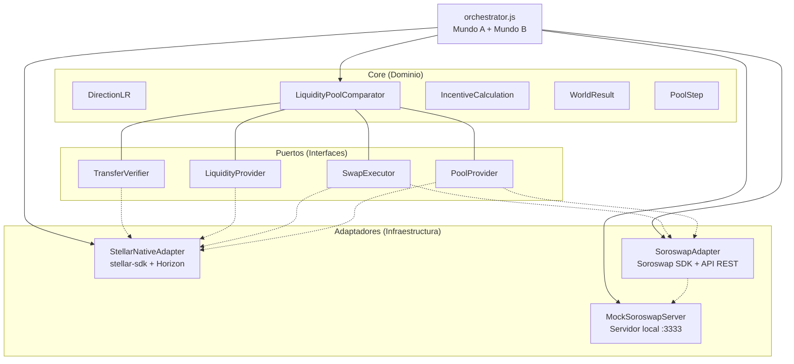

# LabPOOL — Laboratorio de Pools de Liquidez en Stellar

> Comparación técnica entre **AMM nativo de Stellar** (LP no transferible) y **Soroswap / Aquarius** (LP transferible SEP-41) en **Stellar Testnet**.

[](https://github.com/Re-Wallet/LabPOOLS)
[](https://github.com/Re-Wallet/LabPOOLS/commits/main)
[](./LICENSE)
[](https://horizon-testnet.stellar.org)
[](https://nodejs.org)
[](https://www.npmjs.com/package/@soroswap/sdk)
[](https://www.npmjs.com/package/stellar-sdk)

---

## ¿Qué es LabPOOL?

**LabPOOL** es un laboratorio educativo y de investigación que compara dos arquitecturas fundamentales de pools de liquidez (LP) en el ecosistema Stellar:

| Característica | Mundo A: Pool Nativo Stellar | Mundo B: Soroswap / Aquarius |
|----------------|------------------------------|------------------------------|
| Tipo de pool | AMM nativo (Stellar Protocol) | Soroswap SDK (Soroban) |
| LP token | Liquidity Pool Shares | SEP-41 Transferible |
| ¿Transferible entre cuentas? | ❌ **No** | ✅ **Sí** |
| Estándar | Protocol nativo AMM | SEP-41 |
| Red | Stellar Testnet | Soroswap Testnet |
| API / Conector | Horizon API + `stellar-sdk` | Soroswap API REST + `@soroswap/sdk` |
| Funding de cuentas | Friendbot | Mock local o API real |

### Hallazgo principal

En el **AMM nativo de Stellar**, los `liquidity_pool_shares` **no son transferibles** entre cuentas (la operación es rechazada por la red). En **Soroswap (SEP-41)**, los LP tokens **sí son transferibles**, lo que habilita casos de uso DeFi como collateral, mercados secundarios de LP y composición con otros protocolos.

---

## Estructura del repositorio

```
LabPOOL/
├── README.md
├── LICENSE
├── CONTRIBUTING.md
├── SECURITY.md
├── .gitignore
├── docs/
│   ├── ARCHITECTURE.md          # Arquitectura hexagonal (puertos y adaptadores)
│   ├── MERMAID_DIAGRAMS.md      # Diagramas visuales de flujos y arquitectura
│   ├── API_REFERENCE.md         # Endpoints de Soroswap con ejemplos reales
│   ├── ENVIRONMENT.md           # Variables de entorno (tabla completa)
│   ├── DEPLOYMENT.md            # Guía de despliegue y ejecución
│   └── RESEARCH_LINKS.md        # Links oficiales, documentación y credibilidad
└── stellar-lab-lp-swap/         # Laboratorio Stellar LP Swap
    ├── src/
    │   ├── orchestrator.js      # Orquestador: ejecuta Mundo A y Mundo B
    │   ├── mock-soroswap.js     # Servidor mock de Soroswap para testing
    │   ├── fund_accounts.js     # Generador de cuentas con Friendbot
    │   └── test_faucets.js      # Pruebas de faucets externos (Triangle, Acachete)
    ├── config/
    │   └── env.template         # Plantilla de variables de entorno
    ├── data/                    # Datos generados en runtime (gitignored)
    │   ├── data-completo.json
    │   └── funded-accounts.json
    ├── package.json
    └── package-lock.json
```

---

## Diagrama de arquitectura (hexagonal)



---

## ¿Qué se probó en Testnet? (Evidencia real)

El laboratorio se ejecuta contra **Stellar Testnet** (`horizon-testnet.stellar.org`) y **Soroswap Testnet** (`api.soroswap.finance`).

### Mundo A — Pool Nativo de Stellar

| Paso | Acción | Resultado |
|------|--------|-----------|
| 1 | Crear cuentas LP, Trader, Recipient | ✅ Keypairs generados |
| 2 | Friendbot funding | ✅ Cuentas fondeadas |
| 3 | Crear trustlines USDC + XLM | ✅ En Horizon testnet |
| 4 | `liquidityPoolDeposit` (1000 USDC + 2000 XLM) | ✅ Pool creado + TX hash |
| 5 | `pathPaymentStrictSend` (100 USDC → XLM) | ✅ Swap ejecutado |
| 6 | `liquidityPoolWithdraw` (500 shares) | ✅ Retiro exitoso |
| 7 | Intentar transferir `liquidity_pool_shares` | ❌ **Rechazado** — LP no transferible |

**Fee del pool nativo:** 30 bps (0.3%) retenida en el pool.

### Mundo B — Soroswap / Aquarius

| Paso | Acción | Resultado |
|------|--------|-----------|
| 1 | `GET/POST /protocols?network=testnet` | ✅ `["soroswap","sdex","aqua"]` |
| 2 | `POST /quote?network=testnet` | ✅ Quote con `amountOut` calculado |
| 3 | `POST /quote/build?network=testnet` | ✅ XDR de transacción construido |
| 4 | Transferibilidad LP (SEP-41) | ✅ **Transferible** entre cuentas |

**Rate limit plan Free:** 1 req/s, burst 5. El orquestador incluye retry automático para 429 y 503.

---

## Datos comprobados y verificables

| Dato | Valor | Verificable en |
|------|-------|----------------|
| Red | Stellar Testnet | `https://horizon-testnet.stellar.org` |
| Explorador testnet | Ver TX y cuentas | `https://stellar.expert/explorer/testnet` |
| Fee pool nativo | 30 bps (0.3%) | `stellar-sdk` `LiquidityPoolAsset` fee 30 |
| LP nativo transferible | ❌ No | Fallo verificado al intentar `payment` con `liquidity_pool_shares` |
| LP Soroswap transferible | ✅ Sí (SEP-41) | Estándar SEP-41 |
| Plan Free Soroswap | 1 req/s, burst 5 | Headers `X-RateLimit-Limit`, `X-RateLimit-Remaining` |

### Contratos Soroswap verificados en Testnet

| Contrato | ID | Uso |
|----------|-----|-----|
| Token A (USDC) | `CDWEFYYHMGEZEFC5TBUDXM3IJJ7K7W5BDGE765UIYQEV4JFWDOLSTOEK` | `CONTRACT_TKA` |
| Token B (XLM) | `CDLZFC3SYJYDZT7K67VZ75HPJVIEUVNIXF47ZG2FB2RMQQVU2HHGCYSC` | `CONTRACT_TKB` |

---

## Comenzando rápidamente

### 1. Clonar el repositorio

```bash
git clone https://github.com/Re-Wallet/LabPOOLS.git
cd LabPOOLS
```

### 2. Instalar dependencias

```bash
cd stellar-lab-lp-swap
npm install
```

### 3. Configurar variables de entorno

```bash
cp config/env.template .env
```

Edita `.env` con tu `SOROSWAP_API_KEY` (obténla en [console.soroswap.finance](https://console.soroswap.finance)) si quieres usar la API real.

### 4. Ejecutar (modo mock — recomendado para empezar)

**Terminal 1 — Iniciar servidor mock:**
```bash
MOCK_PORT=3333 MOCK_REQUIRE_AUTH=false node src/mock-soroswap.js
```

**Terminal 2 — Ejecutar orquestador:**
```bash
USE_SOROSWAP_MOCK=true MOCK_URL=http://localhost:3333 MOCK_REQUIRE_AUTH=false node src/orchestrator.js
```

### 5. Ejecutar con API real de Soroswap

```bash
USE_SOROSWAP_MOCK=false SOROSWAP_API_KEY=tu_api_key_aqui node src/orchestrator.js
```

### 6. Revisar resultados

```bash
cat data/data-completo.json
```

---

## Documentación técnica

| Documento | Contenido |
|-----------|-----------|
| [`docs/ARCHITECTURE.md`](./docs/ARCHITECTURE.md) | Arquitectura hexagonal, puertos, adaptadores |
| [`docs/MERMAID_DIAGRAMS.md`](./docs/MERMAID_DIAGRAMS.md) | Diagramas Mermaid de flujos y arquitectura |
| [`docs/API_REFERENCE.md`](./docs/API_REFERENCE.md) | Endpoints de Soroswap, ejemplos request/response |
| [`docs/ENVIRONMENT.md`](./docs/ENVIRONMENT.md) | Todas las variables de entorno |
| [`docs/DEPLOYMENT.md`](./docs/DEPLOYMENT.md) | Cómo desplegar y ejecutar |
| [`docs/RESEARCH_LINKS.md`](./docs/RESEARCH_LINKS.md) | Links oficiales, documentación, credibilidad |

---

## Enlaces oficiales y credibilidad

### Stellar
- [Stellar Developers](https://developers.stellar.org) — Documentación principal
- [Stellar Horizon API](https://developers.stellar.org/docs/data) — API de datos
- [Stellar SDK JavaScript](https://developers.stellar.org/docs/js-stellar-sdk) — Referencia `stellar-sdk`
- [Liquidity Pools (AMM)](https://developers.stellar.org/docs/glossary#liquidity-pool) — Pools nativos
- [Friendbot](https://developers.stellar.org/docs/friendbot) — Faucet testnet
- [SEP-41](https://github.com/stellar/stellar-protocol/blob/master/ecosystem/sep-0041.md) — Token transferible

### Soroswap / Aquarius
- [Soroswap Docs](https://docs.soroswap.finance) — Documentación oficial
- [Soroswap Console](https://console.soroswap.finance) — Obtener API key
- [Soroswap SDK (npm)](https://www.npmjs.com/package/@soroswap/sdk) — Paquete oficial
- [Soroswap API](https://api.soroswap.finance) — Endpoint REST
- [Aquarius](https://aquarius.soroswap.finance) — Interfaz sobre Soroswap

### Faucets y explorador Testnet
- [Friendbot Stellar](https://friendbot.stellar.org)
- [Triangle Faucet](https://faucet.triangleplatform.com/stellar/testnet)
- [Acachete Faucet](https://faucet.acachete.com)
- [Stellar Expert Testnet](https://stellar.expert/explorer/testnet) — Explorador de bloques

---

## Licencia

MIT — ver [LICENSE](./LICENSE). Proyecto de investigación educativo; no se recomienda usar con fondos reales en mainnet sin auditoría previa.