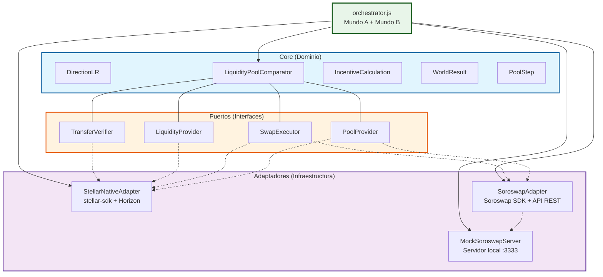
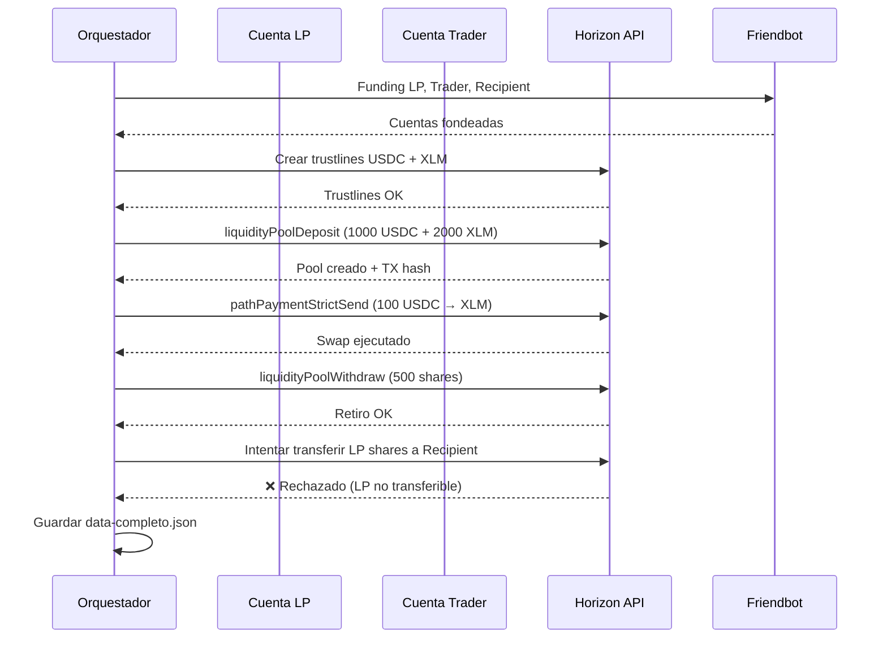
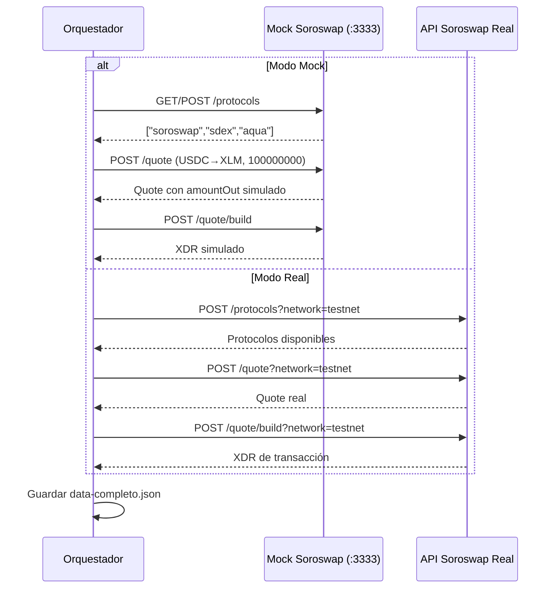
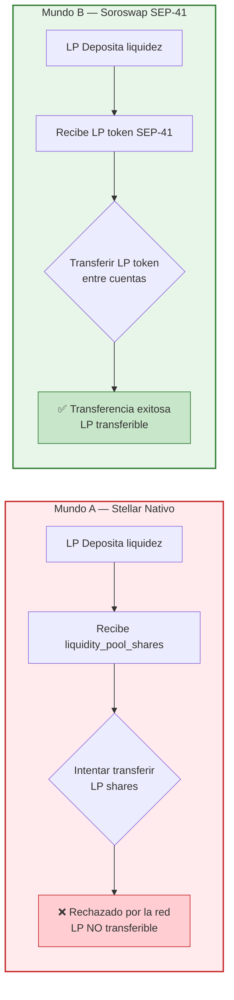
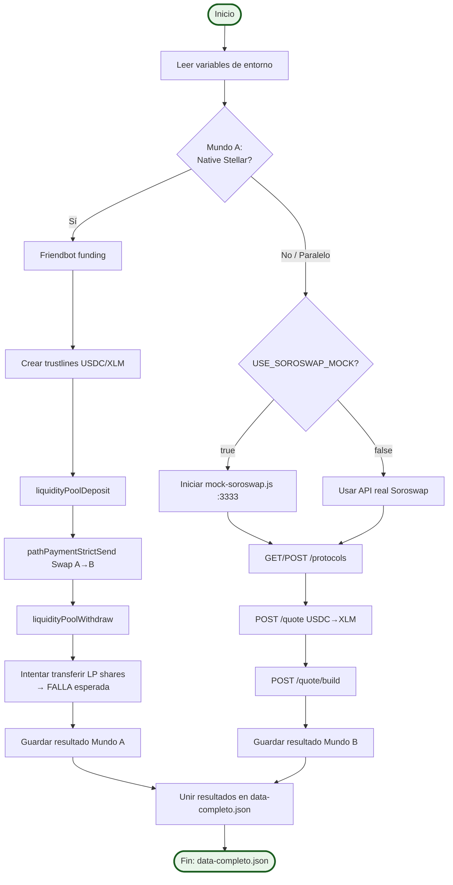

# Diagramas Mermaid — LabPOOL

Diagramas visuales de la arquitectura y flujos del laboratorio. Copia cualquier bloque en [Mermaid Live Editor](https://mermaid.live) para renderizar.

---

## 1. Arquitectura Hexagonal (Puertos y Adaptadores)



---

## 2. Flujo Mundo A — Pool Nativo de Stellar



---

## 3. Flujo Mundo B — Soroswap / Aquarius (mock o real)



---

## 4. Comparativa de Transferibilidad de LP Tokens



---

## 5. Flujo de datos completo (orchestrator)



---

## 6. Despliegue de datos (estado del pool)

```mermaid
stateDiagram-v2
    [*] --> CuentasCreadas
    CuentasCreadas --> TrustlinesCreadas
    TrustlinesCreadas --> PoolCreado
    PoolCreado --> LiquidezDepositada
    LiquidezDepositada --> SwapEjecutado
    SwapEjecutado --> ReservasActualizadas
    ReservasActualizadas --> LiquidezRetirada
    LiquidezRetirada --> TransferenciaIntentada
    TransferenciaIntentada --> [*]

    note right of PoolCreado: Pool ID generado<br/>Reservas iniciales registradas
    note right of SwapEjecutado: 0.3% fee retenida<br/>en el pool
    note right of TransferenciaIntentada: Mundo A: ❌ Rechazada<br/>Mundo B: ✅ Permitida (SEP-41)
```

---

> **Nota**: Estos diagramas están diseñados para usarse en documentación, presentaciones y tesis. Todos son rendereables con [Mermaid Live Editor](https://mermaid.live).